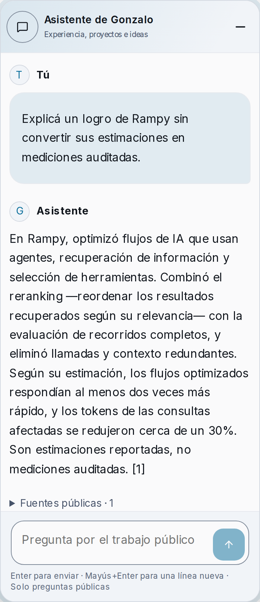
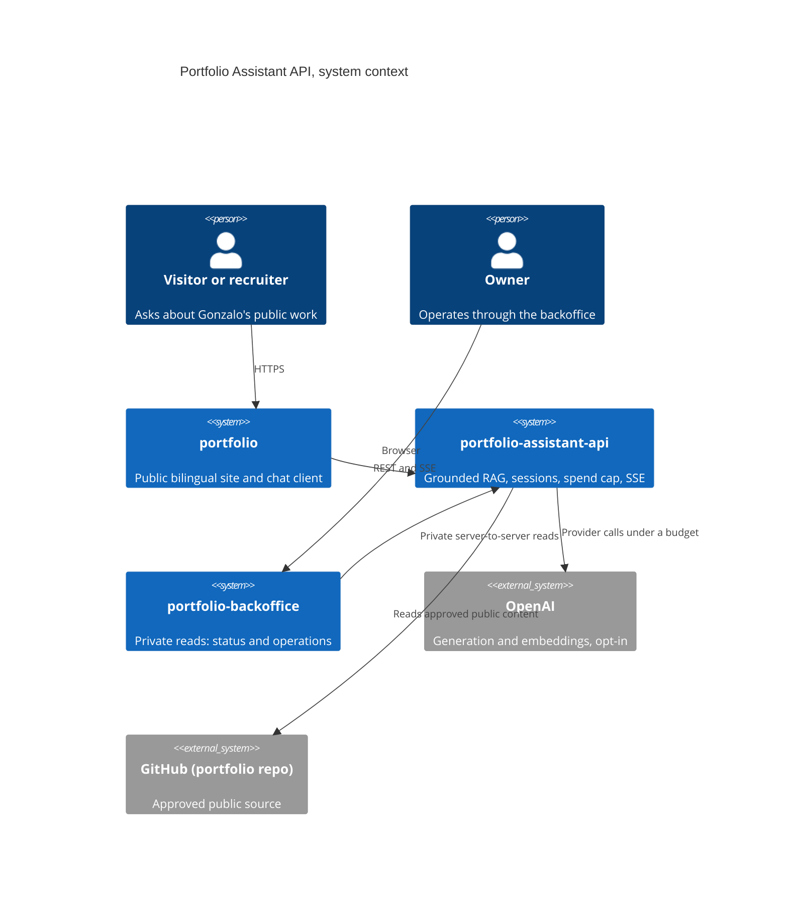
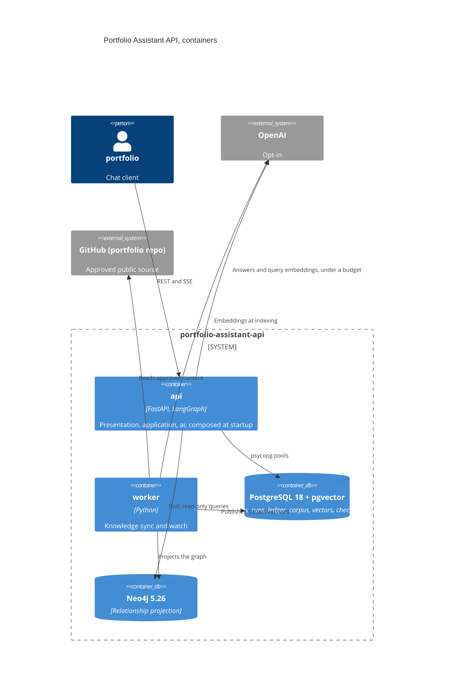

<!-- Variant: PUBLIC -->
<div align="center">
  <h1>Portfolio Assistant API</h1>
  <p>Bilingual, evidence-grounded RAG assistant API with citations, a spend cap and a streaming contract.</p>
  <a href="https://github.com/gonzalomartinperez/portfolio-assistant-api/actions/workflows/ci.yml"></a>
  <a href="https://github.com/gonzalomartinperez/portfolio-assistant-api/releases"></a>
  <a href="LICENSE"></a>
</div>

<p align="center">
  <a href="docs/explanation/gallery.md"><picture>
    <source media="(prefers-color-scheme: dark)" srcset="docs/assets/assistant/compact-dark-en.png">
    </picture></a>
</p>

## Why

Answers about a person must come from published evidence, never from model memory. This API is the
backend of the assistant in Gonzalo Martin Perez's public portfolio. It retrieves approved public
content, validates every citation against that evidence and streams the answer, in US English or neutral
Latin American Spanish. Spend limits, ownership checks and privacy rules are enforced in code, and the
default mode is deterministic fixtures with no paid calls.

## Highlights

- Grounded answers: citations are checked against retrieved public sources; unknown facts stay uncertain ([architecture](docs/explanation/architecture.md)).
- Hybrid retrieval over a versioned public corpus: vector, lexical and a Neo4j evidence graph, with per-rule ablation and a measured graph marginal ([retrieval](docs/explanation/retrieval.md), [ADR 018](docs/decisions/018-neo4j-graph-lane-spike.md)).
- A versioned wire contract (OpenAPI 1.1 plus an SSE schema): RFC 9457 problem documents with English and Spanish messages and retry advice, opt-in progress events, drift-checked in CI ([API contract](docs/reference/api-contract.md)).
- Atomic spend reservations in PostgreSQL and private, bounded operational measurements with no transcripts ([observability](docs/explanation/private-observability.md)).
- Offline quality lanes: an 80-item bilingual golden set with a cassette replay lane, a 384-item development set, a retrieval harness and a 60-item attack pack ([evals](docs/reference/evals.md)).
- Release candidates built in CI with an SPDX SBOM, SLSA provenance and a verified digest, bound to the tested image layers ([deployment contract](docs/reference/deployment-contract.md#release-candidate-mv-r)).
- Measured results come from a scorecard snapshot, see [Quality](#quality).

## Architecture





Dependencies point inward: `src/portfolio_assistant/domain` is pure standard library, `src/portfolio_assistant/application` owns use cases and
ports, and `src/portfolio_assistant/ai`, adapters and presentation depend on it, never the reverse; tests enforce the direction.
Details are in [architecture](docs/explanation/architecture.md) and the [decision records](docs/decisions/README.md). [ADR 028](docs/decisions/028-src-layout-package-rename.md) records the package layout and transition.

## Quickstart

```bash
just sync                  # uv sync --frozen
just check                 # the CI static checks
just test                  # offline unit, contract and architecture tests
```

Requirements: Python 3.14 (uv installs it), [uv](https://docs.astral.sh/uv/), [just](https://just.systems/) and Docker. To run the API
in fixture mode and get a first cited answer with `just demo`, follow the
[local development tutorial](docs/tutorials/local-development.md).

## Usage

With the fixture API from the tutorial running on `localhost:8000` (needs `curl` and `jq`):

```bash
H='Origin: http://localhost:3000'; J='Content-Type: application/json'; API=http://localhost:8000/api/v1
CSRF=$(curl -s -c jar -H "$H" -H "$J" -H 'X-Session-Bootstrap: 1' -d '{}' $API/session | jq -r .csrf_token)
ID=$(curl -s -b jar -H "$H" -H "$J" -H "X-CSRF-Token: $CSRF" -d '{}' $API/conversations | jq -r .id)
curl -N -b jar -H "$H" -H "$J" -H "X-CSRF-Token: $CSRF" -H "Idempotency-Key: $(uuidgen)" \
  -d '{"content":"What is Filomena?","locale":"en"}' $API/conversations/$ID/messages/stream
```

The stream emits `run.started`, `message.delta`, `message.completed` and a terminal `run.completed`,
`run.failed` or `run.cancelled`; a broken connection is not completion. See the
[API contract](docs/reference/api-contract.md) and [contracts/openapi.json](contracts/openapi.json); the assistant UI is in the [light and dark gallery](docs/explanation/gallery.md).

## Quality

| Gate | Tool | Threshold |
|---|---|---|
| `ci-gate` | GitHub Actions, shared engineering-standards action | Every job selected for the change must succeed ([CI](docs/reference/ci.md)) |
| Static | ruff, ruff format, mypy strict over `src` and `evals`, import-linter, vulture | Zero findings and zero errors; ruff backlog families only shrink |
| Offline tests | pytest `-m 'not integration'` | Zero failures; test count is a ratchet in [`scorecard/ratchets/tests.json`](scorecard/ratchets/tests.json) |
| Coverage | coverage.py branch, both lanes combined | Per-layer floors in [`tests/coverage-floors.json`](tests/coverage-floors.json); 90% on changed lines in PRs |
| Mutation | mutmut over domain, application, retrieval and eval-grader modules (changed files on PRs, everything weekly) | Break below the group ratchets in [`tests/mutation-baseline.json`](tests/mutation-baseline.json) |
| Contract | `pytest -m contract`, Schemathesis, oasdiff | No breaking v1 change without the `contract-major` label |
| Retrieval | `evals.harness.retrieval --compare` | Blocks a significant Recall@5 drop against [`evals/baselines/retrieval.json`](evals/baselines/retrieval.json) |
| Golden replay | `just eval-golden` | Every active item replays from committed cassettes; local only until the owner-approved recording campaign commits them |

Latest scorecard snapshot, rendered from committed files by `scripts/readme_results.py`
(see [scorecard tooling](docs/reference/scorecard.md)):

<!-- results:start -->
Generated by `scripts/readme_results.py` from [`scorecard-2026-11-14.json`](docs/evidence/scorecard-2026-11-14.json).

| Check | Result | Source |
|---|---|---|
| Lint (ruff) | 0 findings | [`static.ruff_findings`](docs/evidence/scorecard-2026-11-14.json) |
| Types (mypy) | 0 errors | [`static.mypy_errors`](docs/evidence/scorecard-2026-11-14.json) |
| Types (mypy --strict src) | 89 errors | [`static.mypy_strict_app_errors`](docs/evidence/scorecard-2026-11-14.json) |
| Offline tests | 1,549 tests, 0 failed, 8 skipped | [`tests.unit.total`](docs/evidence/scorecard-2026-11-14.json) |
| Branch coverage (offline lane) | 72.9% | [`coverage.branch_rate`](docs/evidence/scorecard-2026-11-14.json) |
| Integration tests | not measured in this snapshot | [`tests.integration.total`](docs/evidence/scorecard-2026-11-14.json) |
| Golden replay pass rate | not measured in this snapshot | [`eval.golden_pass_rate`](docs/evidence/scorecard-2026-11-14.json) |
| Mutation score | not measured in this snapshot | [`mutation.score`](docs/evidence/scorecard-2026-11-14.json) |
| Image size | not measured in this snapshot | [`image.api_bytes`](docs/evidence/scorecard-2026-11-14.json) |
| Golden set size | 80 items (EN 40, ES 40) | [`evals/golden/manifest.json`](evals/golden/manifest.json) |
| Attack pack size | 60 items | [`evals/attacks/manifest.json`](evals/attacks/manifest.json) |
| Retrieval Recall@5 (hybrid baseline) | 0.810 over 131 scored queries | [`evals/baselines/retrieval.json`](evals/baselines/retrieval.json) |
<!-- results:end -->

## Documentation

| Quadrant | Start here |
|---|---|
| Tutorials | [Local development](docs/tutorials/local-development.md) |
| How-to | [Maintain knowledge](docs/how-to/maintain-knowledge.md) · [Deploy with vps-ops](docs/how-to/deploy-with-vps-ops.md) · [Release](docs/how-to/release.md) · [Roll back a change](docs/how-to/roll-back-a-change.md) |
| Reference | [API contract](docs/reference/api-contract.md) · [Environment](docs/reference/environment.md) · [Evals](docs/reference/evals.md) · [CI](docs/reference/ci.md) · [Scorecard](docs/reference/scorecard.md) · [SLOs](docs/reference/slos.md) |
| Explanation | [Architecture](docs/explanation/architecture.md) · [Threat model](docs/explanation/threat-model.md) · [Graph retrieval](docs/explanation/graph-retrieval.md) |
| Decisions and evidence | [Decision records](docs/decisions/README.md) · [Evidence](docs/evidence/README.md) |
| Master plan | [Master plan](docs/master-plan/README.md) · [Documentation map](docs/README.md) |

## Ecosystem

| Repository | Role |
|---|---|
| [portfolio](https://github.com/gonzalomartinperez/portfolio) | Public bilingual portfolio site |
| [portfolio-assistant-api](https://github.com/gonzalomartinperez/portfolio-assistant-api) | Portfolio assistant API (RAG, evals) |
| [portfolio-backoffice](https://github.com/gonzalomartinperez/portfolio-backoffice) | Portfolio backoffice (IAM, operations) |
| [pequeverso](https://github.com/gonzalomartinperez/pequeverso) | Pequeverso public store site |
| [pequeverso-assistant-api](https://github.com/gonzalomartinperez/pequeverso-assistant-api) | Pequeverso shopping assistant API |
| [pequeverso-backoffice](https://github.com/gonzalomartinperez/pequeverso-backoffice) | Pequeverso backoffice (IAM, operations) |
| vps-ops (private) | Operations CLI and deploy contract |

## Contributing and security

Read [CONTRIBUTING.md](CONTRIBUTING.md) and the [Code of Conduct](CODE_OF_CONDUCT.md). Report vulnerabilities
privately as described in [SECURITY.md](SECURITY.md); questions and bugs are covered by [SUPPORT.md](SUPPORT.md).

## Scope and limits

- The public portfolio assistant stays off until the owner activates it; production deployment is owned by private vps-ops.
- A single-maintainer project: no guaranteed response time and no paid support ([SUPPORT.md](SUPPORT.md)).
- Fixture results do not establish real-model safety; paid calls need explicit owner authorization.
- Only approved public portfolio content enters the runtime corpus.

## License

Code and first-party documentation are [MIT](LICENSE); personal content and third-party material keep their own terms, see [THIRD_PARTY_NOTICES.md](THIRD_PARTY_NOTICES.md).
