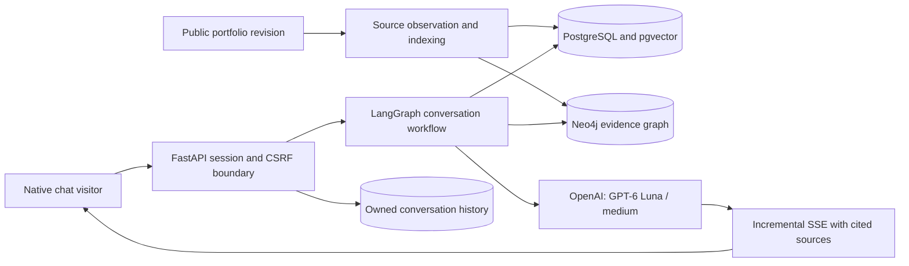
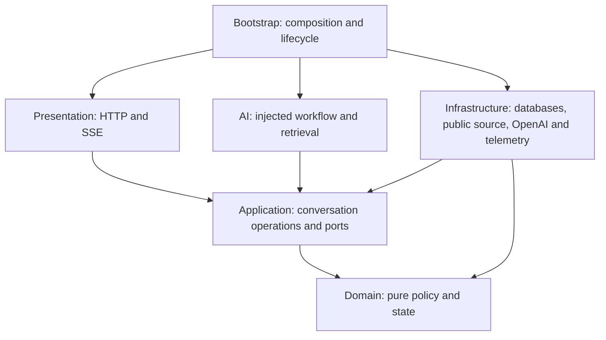
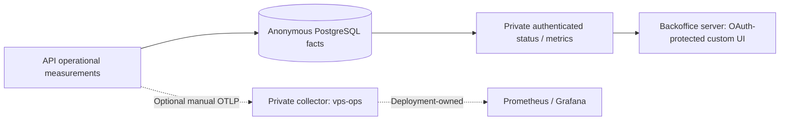

# Portfolio Assistant API

A bilingual, evidence-grounded assistant for Gonzalo Martín Pérez's public
professional profile. It answers questions about projects, experience, education
and skills, carries context across follow-ups, and streams responses with source
links visitors can inspect.


The [portfolio](https://github.com/gonzalomartinperez/portfolio) owns the native chat
interface and approved public knowledge. The
[authenticated backoffice](https://github.com/gonzalomartinperez/portfolio-assistant-backoffice)
owns the custom operational dashboard. This repository owns API/session behavior,
retrieval, generation, persistence and the private operational contract.

**Status:** implemented and locally verified, with fixture and authorized real-model
evidence reported separately. The native portfolio assistant remains disabled.
Production deployment, image publication and shared monitoring activation are not
performed here; private vps-ops manages Coolify on the future Hostinger VPS.

## Conversation and knowledge flow



Only approved public content enters retrieval. Each active index pins an immutable
source revision; continuous synchronization publishes a new complete index before
replacing the previous one. Private career-ops material and evaluation questions
are excluded. Freshness checks can reject generation while knowledge is stale.

The only live model provider is OpenAI. An unavailable provider produces a safe
unavailable response; there is no alternate-model fallback or automatic billed
retry. Neutral Latin American Spanish and US English are supported. Unknown facts
remain uncertain rather than becoming invented achievements or hiring guarantees.

## Free local setup

Use Linux/WSL, Docker Compose and **uv 0.13.0**. uv installs **Python 3.14.8**.
No OpenAI key is required for the deterministic fixture mode.

```sh
uv sync --frozen
export ASSISTANT_PROJECT=assistant-local-demo
export POSTGRES_PORT=55451 NEO4J_PORT=57701 NEO4J_HTTP_PORT=57501
source scripts/fixture-env.sh
docker compose up --build -d --wait
uv run python -m app.migrate
uv run python -m app.knowledge_sync --source github --ref 1acbe54906c88398652aebb8eae0c217fd0d8821
uv run uvicorn app.main:app --host 127.0.0.1 --port 8000 --no-access-log
```

Choose unused ports and a distinct project name. In another terminal, run
`uv run python -m scripts.demo` or add `--locale es`. See
[local development](docs/local-development.md) for environment setup and isolated
real-service verification. Copy only safe configuration placeholders; keep real
secrets in the ignored `.env.local` or Coolify runtime secret delivery.

## Architecture



Feature behavior stays independent from concrete network/storage SDKs. Architecture
tests enforce import direction; strict mypy checks domain, application and AI
contracts. Async streaming owns cancellation, deadline enforcement and cleanup.
Source markers are validated and mapped to the correct persisted answer.

## Private operational dashboard



The implemented server-to-server API exposes observed outcomes, first-fragment
latency, source freshness, configured usage estimates and sampled phase timings.
There are no prompts, transcripts, credentials or visitor identifiers in telemetry.
Private OTLP export is opt-in; collector failures do not retry or interrupt chat.

Prometheus/Grafana deployment and the paired authenticated-browser dashboard remain
separate acceptance gates. Health checks do not make paid model calls or certify
provider availability. Read [the private contract and limitations](docs/private-observability.md).

## Verification and evidence

```sh
uv run ruff check app tests contracts scripts
uv run ruff format --check app tests contracts scripts
uv run mypy
uv run pytest -q
uv run python -m scripts.validate_skills
uv run python -m scripts.validate_compose
uv run python -m contracts.export
```

The ordinary suite skips explicitly marked database integration tests. After preparing
isolated services, run `TEST_INTEGRATION=1 uv run pytest -q`. CI runs static/offline
checks and real-service/container checks in parallel, with frozen dependencies,
pinned actions and a required aggregate gate. Contract export must leave no drift.

- [Private operations verification](docs/verification/private-observability-2026-10-12.md):
  contracts, OTLP receiver, real stores, backoffice adapter and remaining gates.
- [Deep real-model evaluation](docs/verification/live-depth-2026-10-10.md): baseline,
  revalidation, citation/persistence audit, costs and remaining quality limits.
- [Final bilingual voice polish](docs/assistant-voice.md): focused real-model cases
  and topic-retention regression evidence.
- [PostgreSQL 18 verification](docs/verification/postgres18-2026-10-12.md): fresh
  store, pgvector, migrations and container compatibility.
- [1000-question evaluation bank](docs/assistant-evaluation.md): authored intent
  families and fixture coverage, not 1000 independently live-scored answers.

Local measurements are not field performance, physical-device or production results.
Image vulnerability findings and release recovery requirements remain explicit gates.

## Contributor and runtime guides

| Topic | Canonical guide |
| --- | --- |
| Boundaries and lifecycle | [Architecture](docs/architecture.md) |
| HTTP, SSE and contract refresh | [API contract](docs/api-contract.md) |
| Public knowledge synchronization | [Knowledge sync](docs/knowledge-sync.md) |
| Private dashboard data and OTLP | [Observability](docs/private-observability.md) |
| Configuration and secret requirements | [Environment](docs/environment.md) |
| Coolify image/runtime handoff | [Deployment contract](docs/deployment-contract.md) |
| Official LTS and stable exceptions | [Support policy](docs/support-policy.md) |
| CI and dependency review | [CI](docs/ci.md) · [Dependencies](docs/dependency-updates.md) |
| Coding standards and agent skills | [Contributing](CONTRIBUTING.md) · [Skills](docs/agent-skills.md) |
| Security and reporting | [Threat model](docs/threat-model.md) · [Security](SECURITY.md) |
| Bounded remaining acceptance work | [Checklist](docs/work-checklist.md) |

No source license has been selected; public visibility alone does not grant one.
[Third-party notices](THIRD_PARTY_NOTICES.md) record dependency/asset attribution.
