# Portfolio Assistant API

**A grounded conversation about Gonzalo’s work — backed by public evidence.**

The backend for Gonzalo Martín Pérez’s professional assistant: bilingual conversations,
public-portfolio synchronization, hybrid retrieval, streamed answers and private
operational measurements. The public chat lives in the portfolio; this repository
owns the reasoning, contracts and persistence behind it.

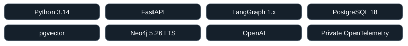

[Explore the assistant](#the-assistant-in-use) · [Run locally](#quick-start-without-a-model-key) · [Architecture](#how-it-works) · [Verification](#verification-and-evidence) · [Documentation](#documentation-map)

> **Current state:** implemented and verified locally with deterministic fixtures and
> separately documented real-model evaluations. The public portfolio assistant remains
> disabled. Production release remains blocked by the
> [dated Neo4j vendor findings](docs/verification/neo4j-release-blocker-2026-10-17.md).
> Source validation does not waive that hold. Publication, deployment and monitoring
> activation require separate approval.

## What this backend does

| Capability | What a visitor or operator gets |
| --- | --- |
| Evidence-grounded answers | Projects, experience, education and skills explained with message-specific public sources. Unknown facts remain uncertain. |
| Context-aware conversation | Follow-up questions retain the visitor’s topic; assistant claims never become retrieval evidence. |
| English and Spanish | US English and neutral Latin American Spanish, with explicit handling of unsupported languages. |
| Current portfolio knowledge | A synchronization worker observes approved public revisions and activates complete, versioned indexes. |
| Reliable streaming | Explicit completion, interruption and cancellation; owned sessions/history and CSRF protection. |
| Private operations | Availability, corpus freshness, execution outcomes, latency and estimated usage without exposing transcripts. |
| Optional website counts | Default-off, bounded accepted interactions with quotas and seven-day aggregates; no visitor journeys. |
| Answer feedback | Default-off private current-rating counts and a reviewed improvement process; no raw-chat export or automatic training. |

The live provider is **OpenAI only**, using **GPT-6 Luna with medium reasoning effort**.
There is no alternate-model fallback or automatic billed generation retry. An unavailable
provider produces an honest unavailable state. Cost figures are configured estimates,
not an OpenAI invoice; reservations and settled usage remain distinct.

## The assistant in use

These are actual browser captures of the native portfolio UI. Completed answers and
citations are replayed from an authorized GPT-6 Luna evaluation through deterministic
HTTP/SSE fixtures. They show the application, not a mockup or an enabled production site.

### Expanded conversation

A recruiter’s question, a substantive answer, inspectable source spans and a follow-up
composer in the same conversation surface.

<p align="center">
  <a href="docs/assets/gallery/02-expanded-conversation.png">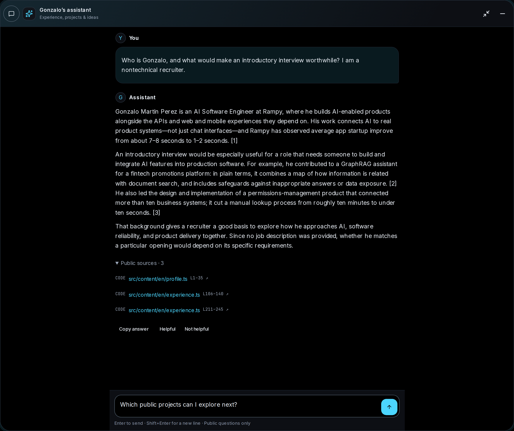</a>
</p>

### From first question to recovery

Click a frame to inspect the original-resolution PNG.

<table>
  <tr>
    <td valign="top" width="50%"><strong>1 · A welcoming starting point</strong><br>Identity, scope and a useful starter question.<br><a href="docs/assets/gallery/01-welcome.png">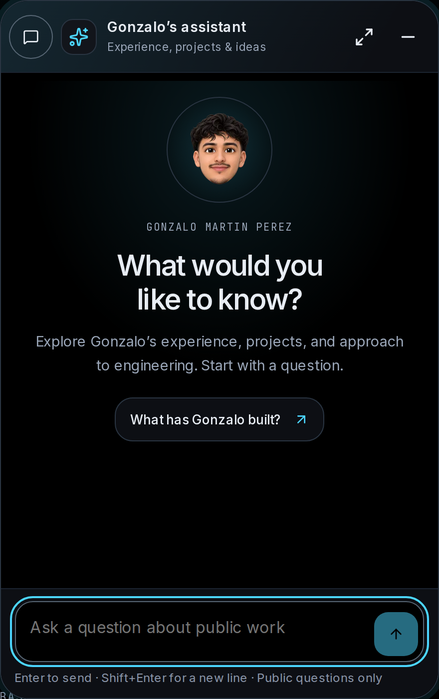</a></td>
    <td valign="top" width="50%"><strong>2 · A compact, sourced answer</strong><br>A recorded achievement with estimates clearly qualified.<br><a href="docs/assets/gallery/03-compact-sources.png">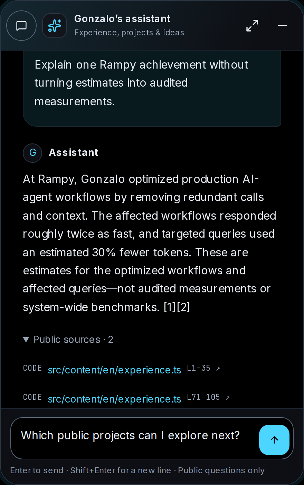</a></td>
  </tr>
  <tr>
    <td valign="top"><strong>3 · Conversation controls</strong><br>History and conversation actions belong to the shared native feature.<br><a href="docs/assets/gallery/04-history.png">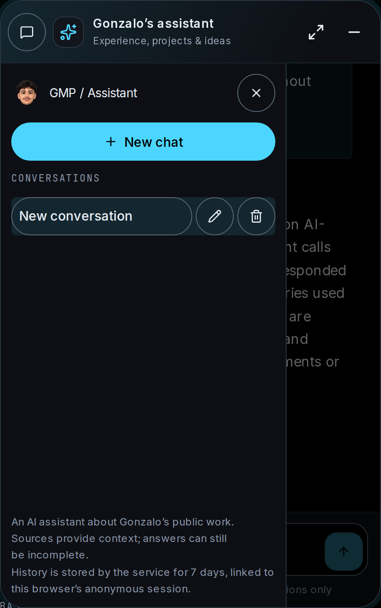</a></td>
    <td valign="top"><strong>4 · Honest interruption</strong><br>Partial output remains readable; recovery checks saved history.<br><a href="docs/assets/gallery/05-interrupted.png">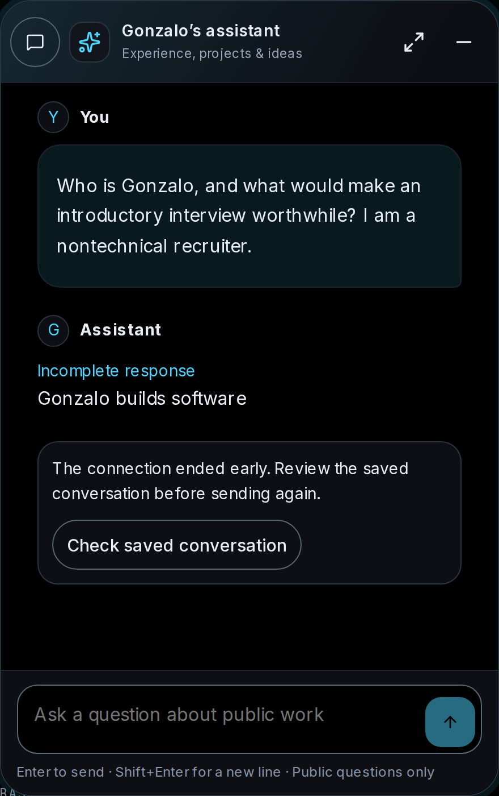</a></td>
  </tr>
</table>

<details>
<summary><strong>Mobile, Spanish/light theme and unavailable-service states</strong></summary>

The narrow viewport uses the same conversation implementation. Long responses scroll
inside the panel; the composer remains separate from the reading surface.

<p align="center">
  <a href="docs/assets/gallery/07-mobile-es.png">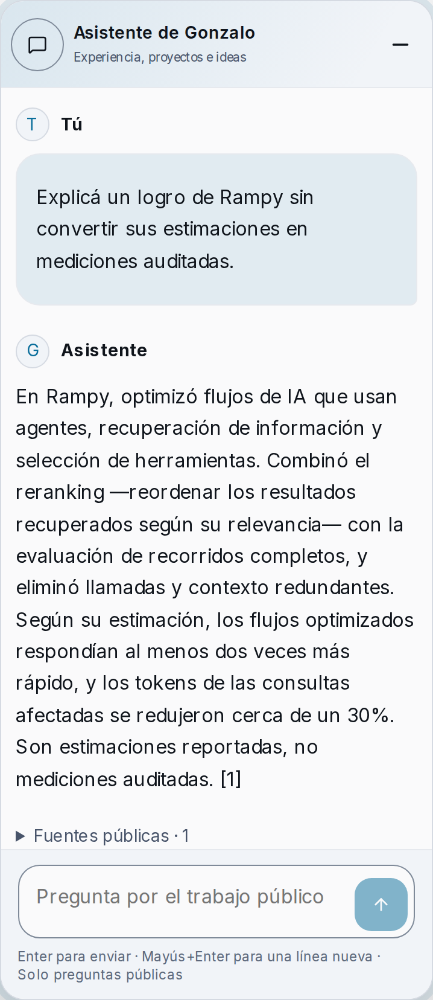</a>
  <a href="docs/assets/gallery/06-unavailable.png">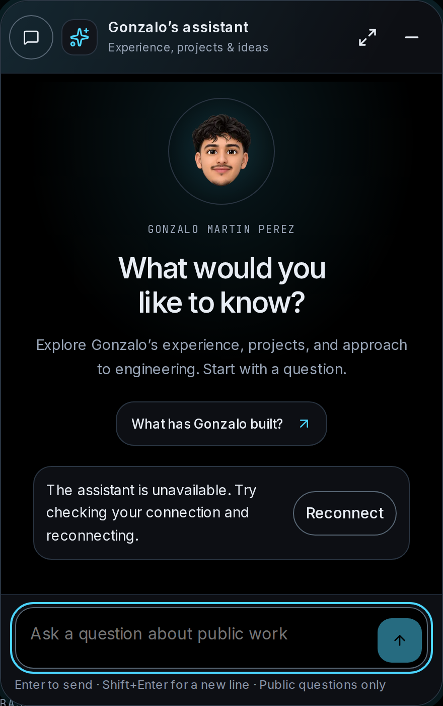</a>
</p>

</details>

[Gallery provenance and limits](docs/verification/readme-gallery.md) distinguish recorded
model output, fixture failures and browser emulation. Captures do not prove physical-device,
production-routing or live-provider availability. No credentials or private visitor messages
are included. The portfolio working tree and disabled rollout were not changed.

## How it works

<p align="center">
  <a href="docs/assets/architecture-overview.svg"></a>
</p>

Solid arrows show requests or synchronization; dashed arrows show returned data.
Frames identify trust boundaries. This overview describes implemented responsibilities,
not production deployment or a security certification. Open the original to zoom. [Diagram source and visual conventions](docs/diagrams.md)
explain the symbols and review procedure.


<details>
<summary>Editable Mermaid view</summary>

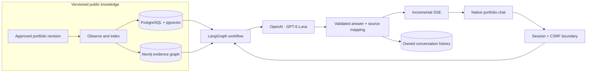

</details>

**Retrieve → ground → generate → validate → persist.** Vector retrieval and graph facts
provide public evidence. The application validates citations against that evidence and
associates them with the persisted answer. Language and presentation context can guide
an answer, but cannot replace evidence or system instructions.

The knowledge worker observes the published public source, pins an immutable revision,
and publishes a complete index before switching the active version. Freshness policy can
reject generation while knowledge is stale. Private career-ops material and authored
evaluation questions never enter the runtime corpus.

### Boundaries and ownership

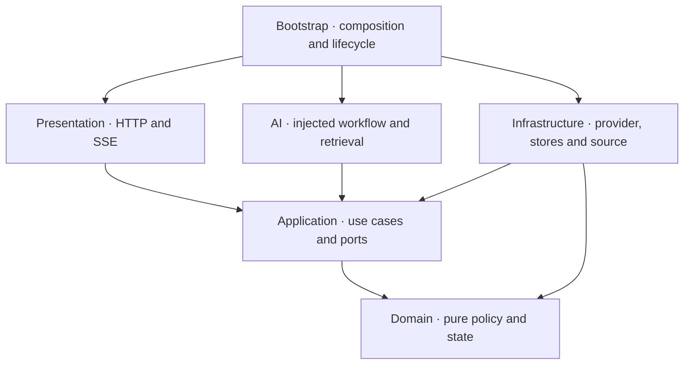

| Location | Responsibility |
| --- | --- |
| `app/domain`, `app/application` | Framework-independent policy, explicit lifecycle and small ports. |
| `app/ai` | LangGraph orchestration and retrieval with injected capabilities. |
| `app/infrastructure`, `app/presentation` | Concrete I/O, validation, HTTP and SSE boundaries. |
| `contracts`, `migrations`, `evals` | Pinned wire artifacts, explicit schema evolution and reproducible evaluation cases. |

Import-boundary tests enforce this direction. Strict mypy covers the inner layers and AI
contracts. Cancellation, deadlines and cleanup are part of application behavior.

The [portfolio](https://github.com/gonzalomartinperez/portfolio) owns the public UI and
approved content; the [backoffice](https://github.com/gonzalomartinperez/portfolio-backoffice)
owns authenticated operations. Private **vps-ops** owns Coolify, proxy/TLS, production
composition, secrets, release selection and recovery. This repository owns its application
image, migrations and runtime contract.

## Quick start without a model key

**Requirements:** Linux/WSL, Git, Docker Compose and uv **0.13.1**. Frozen installation
uses Python **3.14.8**. Run from this repository’s root.

```sh
uv sync --frozen
export ASSISTANT_PROJECT=assistant-readme-demo
# Choose unused loopback ports before sourcing the fixture environment.
export POSTGRES_PORT=55463 NEO4J_PORT=57713 NEO4J_HTTP_PORT=57513
source scripts/fixture-env.sh
docker compose up --build -d --wait
uv run python -m app.migrate
uv run python -m app.knowledge_sync --source github --ref 1acbe54906c88398652aebb8eae0c217fd0d8821
uv run uvicorn app.main:app --host 127.0.0.1 --port 8000 --no-access-log
```

The source command downloads one pinned, approved public portfolio revision. Fixture
mode makes **no paid model or embedding calls**. In a second terminal:

```sh
uv run python -m scripts.demo
uv run python -m scripts.demo --locale es
```

The demo establishes a session, sends a question, receives SSE output and deletes its
session without printing credentials. Liveness is `/health/live`; readiness is
`/health/ready` and requires migrations, an active corpus and graph connectivity.

To stop the selected fixture services, use `docker compose stop` from the terminal
where the fixture environment is loaded. Preserve volumes; do not use `down -v` against
shared environments. [Local development](docs/local-development.md) covers alternate
ports, real-service tests and local source indexing. [Environment](docs/environment.md)
explains private `.env.local` configuration and authorized real-provider setup.

## Public and private contracts

| Surface | Contract |
| --- | --- |
| Sessions and conversations | [`/api/v1` OpenAPI](contracts/openapi.json), including session ownership, CSRF, history/deletion and optional portfolio context. |
| Incremental answers | [SSE schema](contracts/sse.schema.json) and [examples](contracts/sse.examples.json); a broken connection is not completion. |
| Starting questions | `/api/v1/knowledge/suggestions`, grounded in the active approved corpus. |
| Operational snapshot | `/internal/ops/v1/status`, authenticated server-to-server, excluded from public OpenAPI. |
| Operational metrics | `/internal/ops/v1/metrics`, private bearer access and cache exclusion. |

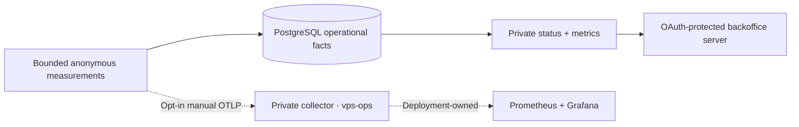

No prompts, transcripts, session credentials or visitor identities enter operational
payloads. Manual OTLP export is opt-in; exporter failures do not retry chat generation.
Health checks never call the paid provider. Shared Prometheus/Grafana deployment and
end-to-end production dashboard pairing remain unverified. See
[the private operations contract](docs/private-observability.md).

## Verification and evidence

```sh
uv run ruff check app tests contracts scripts
uv run ruff format --check app tests contracts scripts
uv run mypy
uv run pytest -q
uv run python -m scripts.validate_skills
uv run python -m scripts.validate_compose
uv run python -m contracts.export
git diff --exit-code contracts
```

For an isolated prepared database/corpus, use `TEST_INTEGRATION=1 uv run pytest -q`.
Ordinary tests explicitly skip those integrations. CI runs static/offline and
real-service/container jobs independently, then requires the aggregate `checks` gate.
Frozen dependencies, pinned actions, current-head checks and image scans remain mandatory.

| Evidence | What was actually verified |
| --- | --- |
| [Deep model evaluation](docs/verification/live-depth-2026-10-10.md) | 300-turn evaluation campaign with real-provider calls, revalidation, citation/history audits and explicit quality limits. |
| [Bilingual voice](docs/assistant-voice.md) | Focused real-model voice checks and follow-up topic-retention regressions. |
| [1000-question bank](docs/assistant-evaluation.md) | Authored bilingual intent families and fixture coverage; not 1000 independently live-scored answers. |
| [Private operations](docs/verification/private-observability-2026-10-12.md) | Runtime mapping, real stores, transport limits, OTLP fixture receiver and backoffice adapter evidence. |
| [PostgreSQL 18](docs/verification/postgres18-2026-10-12.md) | Fresh pgvector store, migrations and container compatibility. |

These are local/test-environment results, not field performance or production guarantees.
Known vendor image findings, effective proxy behavior, backup/restore, live OAuth pairing
and physical-device acceptance remain documented release gates.

## Deployment and documentation

Build the application-owned image with:

```sh
docker build --platform linux/amd64 -t portfolio-assistant-api:local .
```

It runs non-root on private port **8000**. Startup does not migrate or ingest knowledge;
those are explicit operations. vps-ops selects reviewed prebuilt image digests and performs
separately authorized deployment. Main promotion does not authorize publication or deployment.

## Documentation map

| Work | Start here |
| --- | --- |
| Install, configure and connect | [Local development](docs/local-development.md) · [Environment](docs/environment.md) |
| Understand policy and boundaries | [Architecture](docs/architecture.md) · [Engineering coordination](docs/engineering-coordination.md) · [Threat model](docs/threat-model.md) |
| Integrate a client or refresh types | [API contract](docs/api-contract.md) · [Frontend handoff](docs/frontend-handoff.md) |
| Maintain public knowledge | [Knowledge synchronization](docs/knowledge-sync.md) |
| Operate private measurements | [Observability](docs/private-observability.md) |
| Prepare a compatible VPS release | [Runtime contract](docs/deployment-contract.md) · [vps-ops handoff](docs/vps-ops-request.md) |
| Review CI and dependency updates | [CI](docs/ci.md) · [Dependency policy](docs/dependency-updates.md) |
| Contribute or use repository skills | [Contributing](CONTRIBUTING.md) · [Codex/Claude skills](docs/agent-skills.md) |
| Review support and remaining work | [Supported versions](docs/support-policy.md) · [Acceptance checklist](docs/work-checklist.md) |

**License:** no source license has been selected; public visibility does not grant one.
See [third-party notices](THIRD_PARTY_NOTICES.md) and [security reporting](SECURITY.md).

Optional [official-documentation context](docs/bounded-web-context.md) complements
portfolio evidence through closed technical topics; no autonomous browsing or career
facts from general search. It defaults off and shares the application spend ceiling.

Shared runtime/version acceptance: [runtime baseline](docs/runtime-baseline.md).

## Privacy and release gates

Volunteered context supports useful follow-ups; it is not automatic model training.
[Context minimization and the human improvement loop](docs/feedback-and-improvement.md)
describe actual patterns, original-history retention, private rating aggregates and limits.
The [current Neo4j security blocker](docs/verification/neo4j-release-blocker-2026-10-17.md)
prevents a production-ready claim; the rebuilt vendor candidate did not resolve its
fixable Jackson findings. No deployment or collection activation is authorized.
