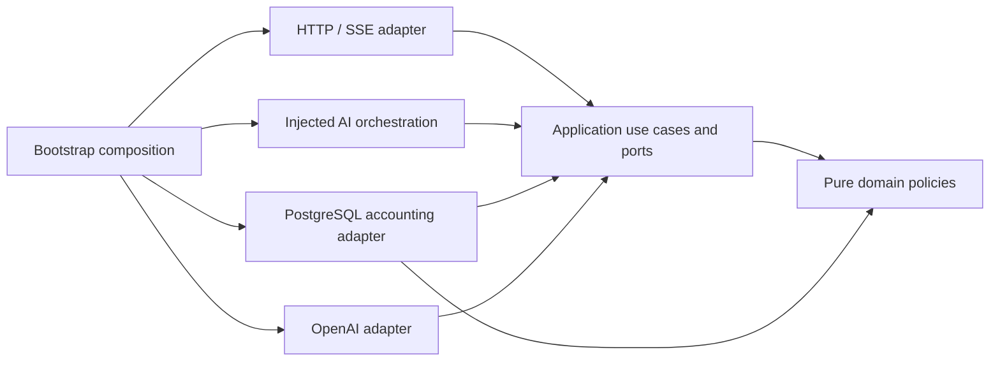

# Architecture and responsibilities

The API is a modular monolith. Six packages express dependency direction and
cohesive capabilities, enforced by `tests/test_architecture.py`:

```text
presentation ──► application ──► domain
ai ────────────► application ──► domain
infrastructure ► application ──► domain
bootstrap composes presentation + application + ai + infrastructure
```

| Package | Responsibility |
| --- | --- |
| `domain` | Pure provenance, lexical/graph fact and cost policies; value objects/errors |
| `application` | Conversation and run use cases; workflow/retrieval/provider/accounting/storage ports |
| `ai` | Injected LangGraph workflow and deterministic retrieval orchestration |
| `infrastructure` | psycopg, pgvector, Neo4j, public Git indexing, Responses translation and migrations |
| `presentation` | FastAPI routes, cookie/origin/CSRF transport, typed SSE and request guards |
| `bootstrap` | Validated settings, explicit composition, shared resources and structured logs |

Inner layers import only the standard library and domain/application code.
AI code imports no concrete storage/provider implementation. Infrastructure's CLI
entry points still use the settings adapter in `bootstrap.config`; the HTTP
composition injects its connection and pricing capabilities. The architecture
test allows only that settings module, never the composition root. This explicit
CLI exception avoids a generic container/service-locator framework.

## One request

The browser bootstraps an anonymous secret cookie and CSRF token. Application
policy authenticates the secret digest. Persistence checks session ownership
inside each transaction and atomically creates a run/user message. A bounded
LangGraph retrieve → answer workflow returns application events. Public evidence
is verified and capped before a fixture or Responses provider generates text.
Only intentionally public progress and deltas reach SSE. Completion atomically
persists the assistant message/citations and run state before terminal delivery.

The final answer model has no autonomous tools, shell capabilities, arbitrary queries
or indexing HTTP endpoints. Optional official-documentation context uses a closed-topic
search adapter with separate accounting; see [its boundaries](bounded-web-context.md).
Indexing is an operator CLI over approved public sources. No conversation text is
copied into knowledge or a long-term memory store.

## Transactions and concurrency

Each storage operation borrows its own connection and transaction. Shared pools
are not shared transactions. PostgreSQL row/advisory locks protect ownership,
conversation allocation, active-run counts, rate counters, monthly reservations,
migration application and indexing activation. The global active-run bound is
four; PostgreSQL enforces one active run per conversation. The application never
sees cursors, database rows or vendor response objects.

HTTP lifespan owns an eight-connection SQL pool, a four-connection asynchronous
checkpoint pool, a four-connection graph pool and an optional async provider
client. CLI commands use bounded per-operation connections. Imports open no
network connections. Startup opens pools; shutdown closes provider, checkpoint,
graph and SQL resources in a `finally` block.

## Streams and failure

A gated async fake verifies incremental delivery before provider completion.
Fixture deltas are deliberately sliced literal excerpts and are documented as
such. Runs poll persisted cancellation every 100 ms while waiting for silent
upstream work, with a 60-second default total deadline and a 12,000-character
output cap. Closing an HTTP stream closes the workflow/provider; the ASGI adapter
also closes generators after send failures. Uvicorn allows 15 seconds for graceful
shutdown before cancellation. No partial answer becomes a completed history row.

A provider or workflow failure produces the existing `run.failed` envelope.
Unknown usage retains its reservation. When storage fails after headers, terminal
failure is delivered if the connection remains usable, but persisted state is
unknown until the five-minute lease is reconciled. A disconnected client cannot
receive a terminal event; it must query the run after reconnecting. Runs are never
implicitly replayed. Mutations/model calls are not automatically retried; indexing
and cleanup are explicitly idempotent and retryable.

## Deletion and cleanup

Deleting an owner atomically cascades conversation data and enqueues checkpoint
IDs. Best-effort bounded cleanup follows; the retention command retries the durable
queue. Recent tombstones remain for ten minutes to catch late checkpoint writes
from cancelling runs. Run the retention command every minute in deployment.
Expired sessions are rejected immediately; physical deletion follows that schedule.
Spend totals retain amount/time for budget enforcement, with deleted run references
set to null. See [privacy and threats](threat-model.md) and [operations](deployment.md).

See [ADR 001](adrs/001-dependency-direction.md), [GraphRAG](graph-retrieval.md),
and [stream contract](api-contract.md) for decisions and behavior details.

## Bounded conversational context

RunStore loads earlier turns only for the claimed run/conversation and unexpired
session, before generation. Application policy caps 12 turns to 8,000 characters;
evidence remains independently verified and capped at 19,000 characters. LangGraph
receives plain Turn contracts, not database rows. Retrieval resolves explicit
follow-ups without a model routing call. The provider receives the current question,
untrusted history and public evidence separately. See conversation-evaluation.md.

## Operational observation boundary

The pure application observation model accepts bounded scalar measurements only.
Infrastructure queues/persists them and optionally exports manual private OTLP.
Presentation owns the versioned bearer-authenticated operational read API.
No operational payload is sent through public chat/SSE or shares visitor identifiers.
See [private observability](private-observability.md) for retention and drop semantics.

## Enforced architectural contracts

`tests/test_architecture.py` exercises the real stdlib AST checker in
`scripts/check_architecture.py`, including negative examples. Run it alone with
`uv run python -m scripts.check_architecture`; the existing required Quality job
runs the same guard through the offline test suite. No extra build or service is needed.

The guard resolves absolute, relative and `from package import module` dependencies,
checks module cycles, rejects unclassified application packages and prevents dynamic
import/code-loading bypasses. Domain/application reject third-party dependencies and
selected direct platform I/O imports. This is a regression guard, not a Python sandbox
or proof that arbitrary standard-library code is side-effect free; review still checks
behavior and capability ownership.

Five existing operator modules (`db`, `ledger`, `migrations`, `indexing`, `checkpoints`)
retain explicit `bootstrap.config` defaults for compatibility with documented CLI
commands. The allowlist names these modules individually; it grants no general
infrastructure-to-bootstrap permission. New adapters receive their inputs explicitly.

Search pricing now belongs to immutable `domain.web_budget.WebBudget`. Application owns
`SearchAccounting`; the OpenAI search adapter consumes that port, and PostgreSQL
implements it. Bootstrap converts validated configuration into decimal policy values
and injects them. The database adapter owns atomic reservation/settlement; the policy
owns the full-window ceiling, long-context rates and rounding. Neither pricing nor
its tests require Pydantic, OpenAI, PostgreSQL or environment variables. Existing wire
contracts, billed-call cancellation policy and runtime defaults remain unchanged.



See [engineering coordination](engineering-coordination.md) for cross-session ownership
and the primary references behind these adaptations.
