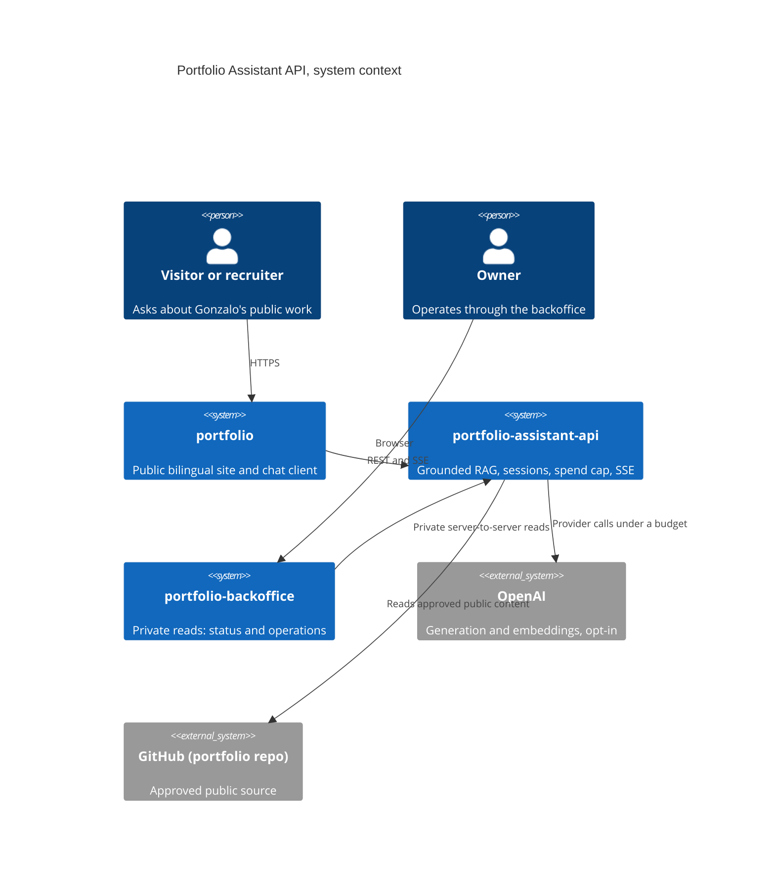
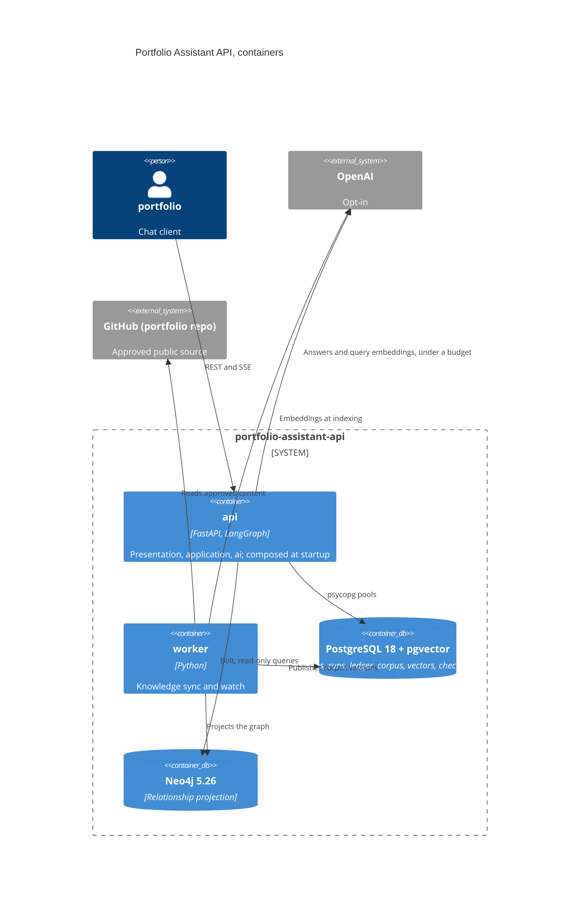
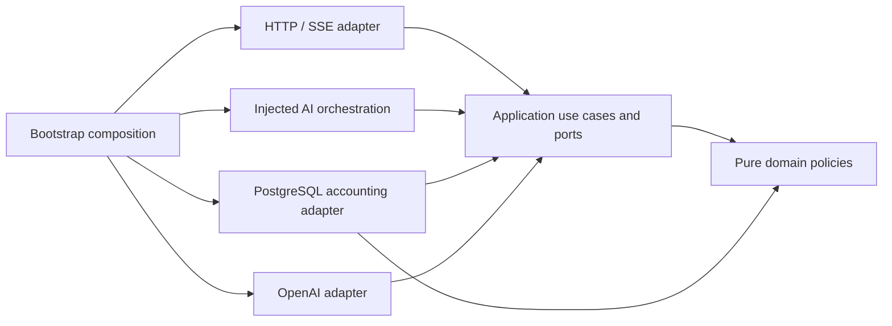

# Architecture and responsibilities

The API is a modular monolith. Six packages express dependency direction and
cohesive capabilities, enforced by `tests/architecture/test_architecture.py`:

```text
presentation ──► application ──► domain
ai ────────────► application ──► domain
adapters ──────► application ──► domain
bootstrap composes presentation + application + ai + adapters
```

| Package | Responsibility |
| --- | --- |
| `domain` | Pure provenance, lexical/graph fact and cost policies; value objects/errors |
| `application` | Conversation and run use cases; workflow/retrieval/provider/accounting/storage ports |
| `ai` | Injected LangGraph workflow and deterministic retrieval orchestration |
| `adapters` | psycopg, pgvector, Neo4j, public Git indexing, Responses translation and migrations |
| `presentation` | FastAPI routes, cookie/origin/CSRF transport, typed SSE and request guards |
| `bootstrap` | Validated settings, explicit composition, shared resources and structured logs |

Inner layers import only the standard library and domain/application code.
AI code imports no concrete storage/provider implementation. Concrete capability
packages are `adapters/postgres`, `providers`, `portfolio`, `neo4j` and
`observability`, plus the hybrid retrieval adapter. Configuration defaults and
operator orchestration live in bootstrap; adapters receive explicit settings values
and connection/publish capabilities. No adapter may import bootstrap or a legacy facade.

The obsolete `portfolio_assistant.infrastructure` package is removed. AST checks reject its
reintroduction and all adapter→bootstrap backedges. Root ASGI/CLI paths remain
stable; see [ADR006](../decisions/006-canonical-adapters.md) and the
[pre-move consumer map](../evidence/archive/2026-10/common-layout-preflight-2026-10-18.md).

## System context and containers

The [README](../../README.md#architecture) carries the same two C4 views.





## One request

The browser bootstraps an anonymous secret cookie and CSRF token. Application
policy authenticates the secret digest. Persistence checks session ownership
inside each transaction and atomically creates a run/user message. A bounded
LangGraph retrieve → answer workflow returns application events. Public evidence
is verified and capped before a fixture or Responses provider generates text.
Only intentionally public progress and deltas reach SSE. Completion atomically
persists the assistant message/citations and run state before terminal delivery.

The final answer model has no autonomous tools, shell capabilities, arbitrary queries
or indexing HTTP endpoints. Optional official-documentation context uses a closed-topic
search adapter with separate accounting; see [its boundaries](bounded-web-context.md).
Indexing is an operator CLI over approved public sources. No conversation text is
copied into knowledge or a long-term memory store.

## Transactions and concurrency

Each storage operation borrows its own connection and transaction. Shared pools
are not shared transactions. PostgreSQL row/advisory locks protect ownership,
conversation allocation, active-run counts, rate counters, monthly reservations,
migration application and indexing activation. The global active-run bound is
four; PostgreSQL enforces one active run per conversation. The application never
sees cursors, database rows or vendor response objects.

HTTP lifespan owns an eight-connection SQL pool, a four-connection asynchronous
checkpoint pool, a four-connection graph pool and an optional async provider
client. CLI commands use bounded per-operation connections. Imports open no
network connections. Startup opens pools; shutdown closes provider, checkpoint,
graph and SQL resources in a `finally` block.

## Streams and failure

A gated async fake verifies incremental delivery before provider completion.
Fixture deltas are deliberately sliced literal excerpts and are documented as
such. Runs poll persisted cancellation every 100 ms while waiting for silent
upstream work, with a 60-second default total deadline and a 12,000-character
output cap. Closing an HTTP stream closes the workflow/provider; the ASGI adapter
also closes generators after send failures. Uvicorn allows 15 seconds for graceful
shutdown before cancellation. No partial answer becomes a completed history row.

A provider or workflow failure produces the existing `run.failed` envelope.
Unknown usage retains its reservation. When storage fails after headers, terminal
failure is delivered if the connection remains usable, but persisted state is
unknown until the five-minute lease is reconciled. A disconnected client cannot
receive a terminal event; it must query the run after reconnecting. Runs are never
implicitly replayed. Mutations/model calls are not automatically retried; indexing
and cleanup are explicitly idempotent and retryable.

## Deletion and cleanup

Deleting an owner atomically cascades conversation data and enqueues checkpoint
IDs. Best-effort bounded cleanup follows; the retention command retries the durable
queue. Recent tombstones remain for ten minutes to catch late checkpoint writes
from cancelling runs. Run the retention command every minute in deployment.
Expired sessions are rejected immediately; physical deletion follows that schedule.
Spend totals retain amount/time for budget enforcement, with deleted run references
set to null. See [privacy and threats](threat-model.md) and [operations](../how-to/deploy-with-vps-ops.md).

See [ADR 001](../decisions/001-dependency-direction.md), [ADR 014](../decisions/014-prompt-registry.md), [GraphRAG](graph-retrieval.md),
and [stream contract](../reference/api-contract.md) for decisions and behavior details. The offline
evaluation harness (`evals/harness`, outside the image) is recorded in
[ADR011](../decisions/011-eval-harness.md); its cassette lane in [ADR013](../decisions/013-provider-port-cassettes.md).

## Bounded conversational context

RunStore loads earlier turns only for the claimed run/conversation and unexpired
session, before generation. Application policy caps 12 turns to 8,000 characters;
evidence remains independently verified and capped at 19,000 characters. LangGraph
receives plain Turn contracts, not database rows. Retrieval resolves explicit
follow-ups without a model routing call. The provider receives the current question,
untrusted history and public evidence separately. See conversation-evaluation.md.

## Operational observation boundary

The pure application observation model accepts bounded scalar measurements only.
Infrastructure queues/persists them and optionally exports manual private OTLP.
Presentation owns the versioned bearer-authenticated operational read API.
No operational payload is sent through public chat/SSE or shares visitor identifiers.
See [private observability](private-observability.md) for retention and drop semantics.

## Enforced architectural contracts

`uv run lint-imports` enforces the layer, forbidden-import and acyclic sibling
contracts from [ADR 010](../decisions/010-import-linter-contracts.md). The residual
AST guard checks wall-clock reads, dynamic code and imports, unclassified modules and
import targets, the standard-library-only rule and `urllib.request` ban in domain and
application, module-level cycles, package initializers, `__main__` blocks and
console-script targets. Run it with `uv run python -m scripts.check_architecture`
or through the architecture tests in the offline suite.

Operator defaults now live exclusively in bootstrap. Migration, indexing and
maintenance commands inject explicit configuration and connection capabilities
into adapters; there is no legacy import or layer exception.

Search pricing now belongs to immutable `domain.web_budget.WebBudget`. Application owns
`SearchAccounting`; the OpenAI search adapter consumes that port, and PostgreSQL
implements it. Bootstrap converts validated configuration into decimal policy values
and injects them. The database adapter owns atomic reservation/settlement; the policy
owns the full-window ceiling, long-context rates and rounding. Neither pricing nor
its tests require Pydantic, OpenAI, PostgreSQL or environment variables. Existing wire
contracts, billed-call cancellation policy and runtime defaults remain unchanged.



See [engineering coordination](engineering-coordination.md) for cross-session ownership
and the primary references behind these adaptations.

## Diagrams

The [overview SVG](../assets/architecture-overview.svg) is a first-party editable vector
source, not a screenshot or generated UI. The README keeps the equivalent Mermaid
logical view in a native disclosure. Update both when a responsibility or flow changes;
this is a context/component overview, not a class diagram or deployment acceptance.
The asset contains no scripts, foreign HTML, external images/fonts or remote requests.
No diagram/runtime dependency or proprietary design tool is needed to edit it.

| Question | Suitable view | Orientation |
| --- | --- | --- |
| Who calls what, across which boundary? | System context / components | Left-to-right for a short request pipeline |
| What happens in time? | UML sequence | Actors across; time down |
| Which decision or release gate follows? | Activity / flow | Top-to-bottom for long phases and gates |
| Which legal transition or relationship matters? | State / class UML | Match the actual model; avoid decorative taxonomy |

Cards identify components; dashed frames identify trust boundaries. Solid arrows are
requests/synchronization; dashed arrows return data. A two-ended arrow identifies a
read/lookup exchange. Labels carry meaning independently of color. Ownership, access
and missing observations remain explicit; no arrows imply automatic training, public
service-token access or production activation.

The overview uses a small neutral/cyan palette aligned with the portfolio. CSS variables
centralize canvas, surfaces, text, borders and connectors. `prefers-color-scheme`
provides light/dark variants inside the same source; system fonts avoid remote assets.
Measured minimum text contrast is5.21:1 (light) /8.87:1 (dark); meaningful connectors
and boundary strokes are at least3.53:1 /4.49:1. Values use sRGB relative luminance.
See [embedded color-scheme behavior](https://developer.mozilla.org/en-US/docs/Web/CSS/Reference/At-rules/prefers-color-scheme).
It is a static document graphic: no decorative animation, tracking or JavaScript.

Review at full intrinsic size and in a390px README context, both themes. Check text
fits its card, connectors do not cross labels, title/legend are legible, original-image
zoom works and accompanying prose/alt text explains the flow without depending on the
figure. The compact inline preview is an overview; open the original for small labels.
README diagram presentation uses a centered `<p align="center">` and `<picture>`
with meaningful image alt text; the owned SVG handles both palettes in one asset.
Captions and Markdown links stay outside the HTML paragraph. Editable Mermaid
semantics are labeled text-code in collapsed details, not additional uncentered
rendered diagrams. Inner documentation may render Mermaid; verify it on GitHub. A graphical
edit is documentation work, never authority to alter contracts or infrastructure.

Local visual evidence is ignored under `.artifacts/architecture-review` in the backoffice
workspace; the delivery report identifies the exact source and checks actually run.
No physical-device or screen-reader certification follows from this diagram review.
