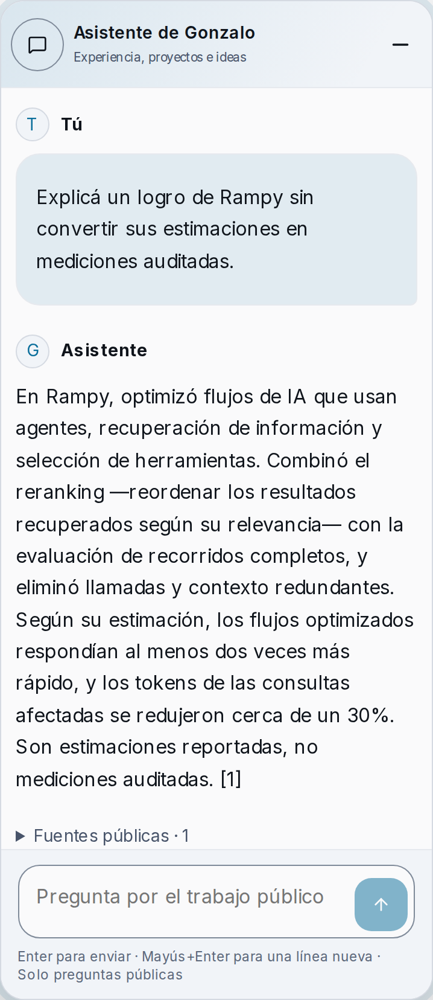
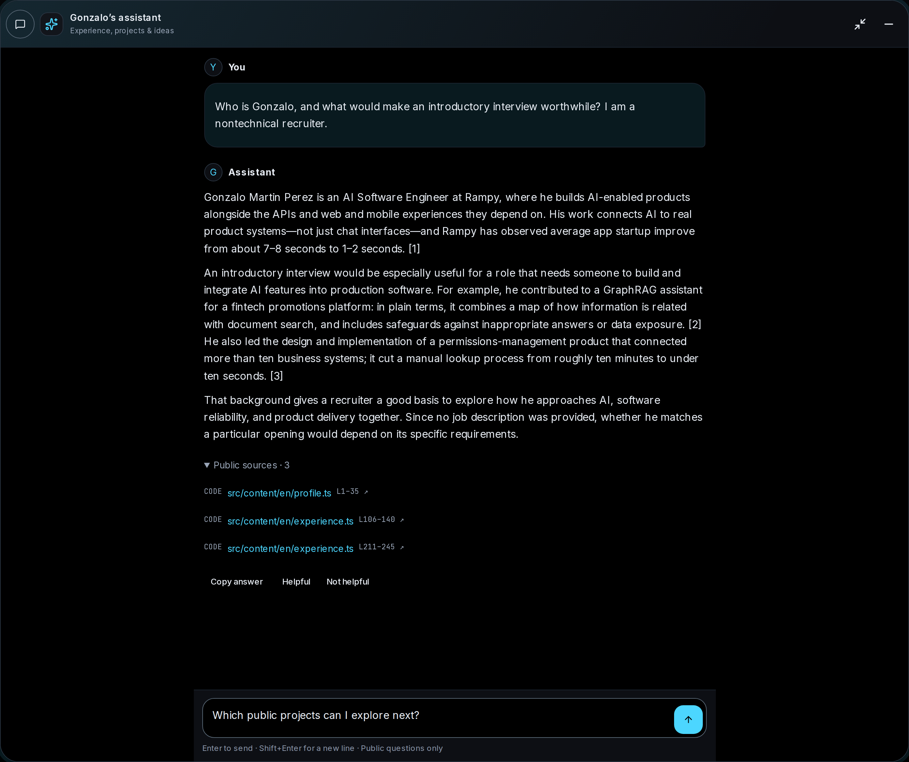
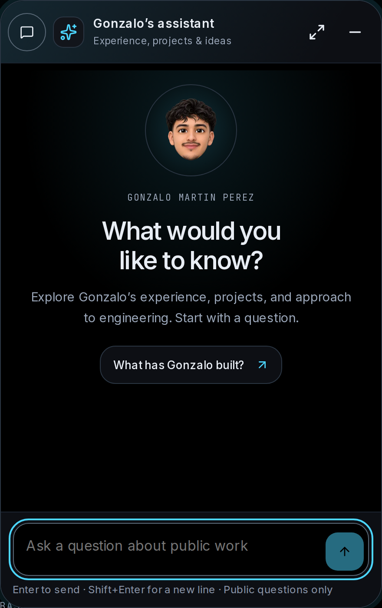
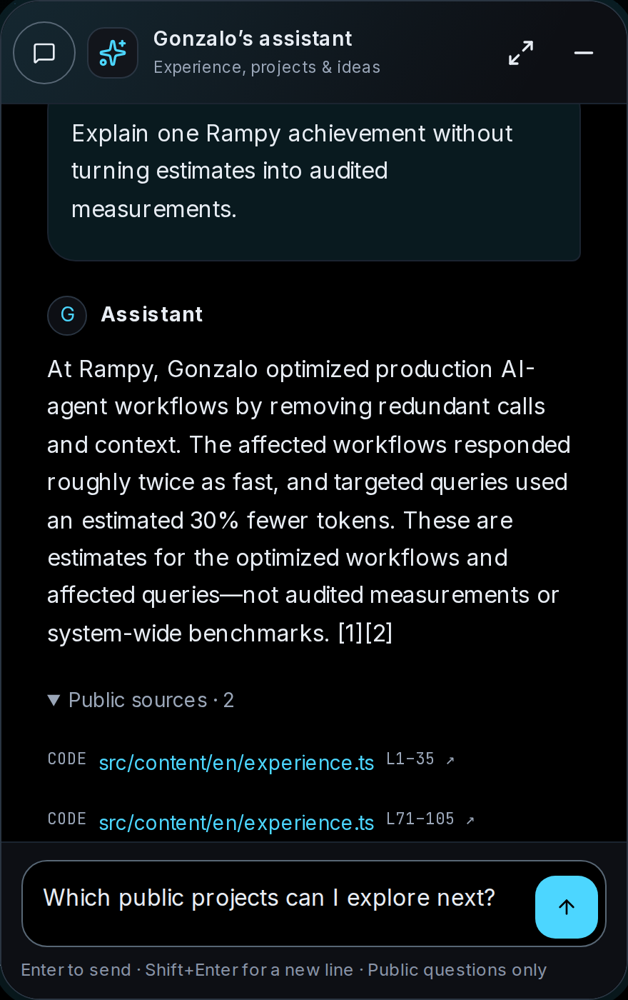
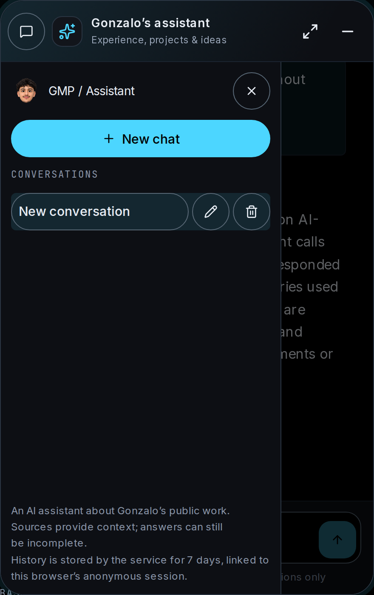
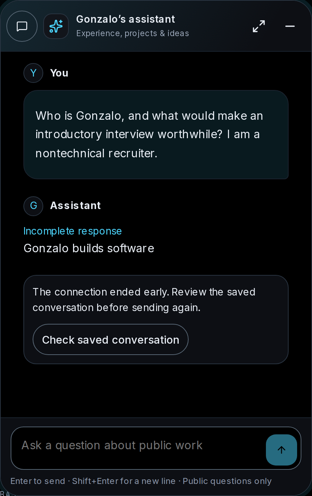
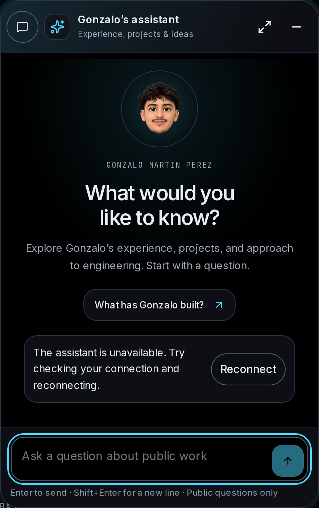

# Assistant gallery, light and dark

These are browser captures of the native portfolio UI. Completed answers and citations are replayed from an
authorized GPT-6 Luna evaluation through deterministic HTTP/SSE fixtures. They show the application, not a
mockup or an enabled production site. Click a frame to open the original PNG.

## Light theme

The narrow viewport uses the same conversation implementation as the desktop layout. Long responses scroll
inside the panel; the composer stays separate from the reading surface.

  

## Dark theme

### Expanded conversation

A recruiter's question, a substantive answer, inspectable source spans and a follow-up composer in the same
conversation surface.

  

### From first question to recovery

<table>
  <tr>
    <td valign="top" width="50%"><strong>1. A welcoming starting point</strong> Identity, scope and a useful starter question. </td>
    <td valign="top" width="50%"><strong>2. A compact, sourced answer</strong> A recorded achievement with estimates clearly qualified. </td>
  </tr>
  <tr>
    <td valign="top"><strong>3. Conversation controls</strong> History and conversation actions belong to the shared native feature. </td>
    <td valign="top"><strong>4. Honest interruption</strong> Partial output stays readable; recovery checks saved history. </td>
  </tr>
  <tr>
    <td valign="top"><strong>5. Unavailable service</strong> A safe notice with recovery controls. </td>
    <td valign="top"><strong>6. Compact dark theme</strong> The hero capture of the README, in English. </td>
  </tr>
</table>

## Provenance and limits

[Gallery provenance](../evidence/archive/2026-10/readme-gallery.md) distinguishes recorded model output,
fixture failures and browser emulation. Captures do not prove physical-device, production-routing or
live-provider availability. No credentials or private visitor messages are included.
