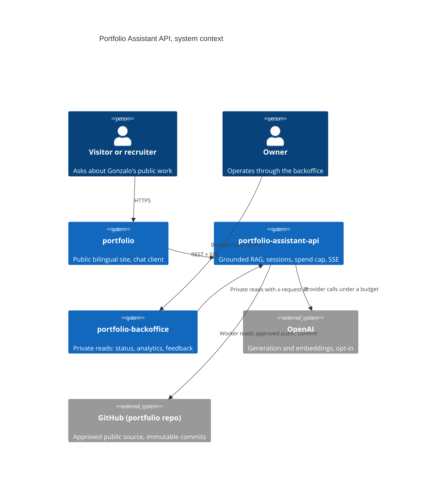
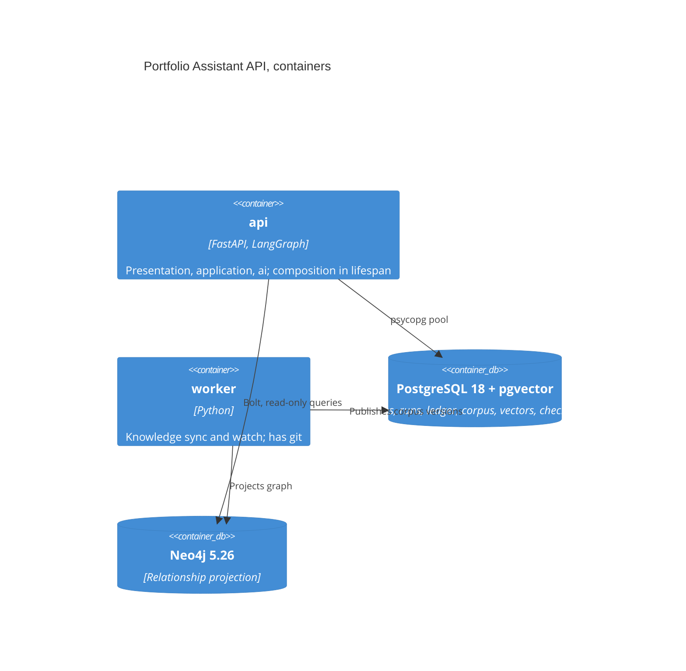

# Documentation and community files

Applies ecosystem section 14. Research: [08](research/08-docs-readme-skills.md). Baseline: README 339 lines with caveats before results, 34 documents plus 46 dated verification records without hierarchy, ADRs 001-006 and 008 (007 missing), `IMPLEMENTATION_STATUS.md` and `docs/work-checklist.md` carrying volatile status, no CHANGELOG, community files limited to LICENSE, SECURITY, CONTRIBUTING and one issue template ([audit.md](audit.md)).

## 1. Proposed README outline (public variant, at most 250 lines, checked by a heading script)

1. **Title and one line**: "Portfolio Assistant API: a bilingual, evidence-grounded RAG assistant with citations, an atomic spend cap and a streaming contract." Three badges: CI, release, license.
2. **Why**: the problem (answers about a person must come from published evidence, never from model memory) and the three design choices (grounded retrieval with provenance and graph, deterministic invariants plus a 100% golden gate, spend and privacy controls enforced in code).
3. **Demo and proof** (the block that was missing): the dated results table below, a 30-second terminal capture or the existing gallery in `<picture>` light and dark pairs, and `just demo`.

   | Check | Result | Run |
   |---|---|---|
   | Golden set (80 items, EN 40 and ES 40) | 80/80, cassette replay | CI run link, commit, date |
   | Golden live pass^3 | "not run" until authorized, then 80/80 x 3 | release run link |
   | Full set (about 450, 100 holdout), Recall@5 per family, EN-ES gap | table or "not yet run" | report link |
   | Answer latency and cost p95 | stubbed lane and recorded lane | budgets report |
   | Mutation score, branch coverage | numbers from the last nightly | scorecard link |

   The table is generated from `scorecard.json` by a script, never hand-typed (no volatile facts, ecosystem 14.2).
4. **Architecture**: C4 level 1 and 2 Mermaid (below), plus one paragraph on boundaries and ownership (vps-ops deploys, this repo owns image, contract, migrations).
5. **Quickstart**: `git clone`, `just demo` (uv, fixture mode, containers, no key needed); one command to the first cited answer.
6. **Usage**: three `curl` calls (session, conversation, SSE stream) and the event list.
7. **Tech stack**: FastAPI, LangGraph, PostgreSQL 18 with pgvector, Neo4j 5.26, OpenAI Responses API (opt-in), Python 3.14, uv.
8. **Quality**: scorecard summary line per lens and the link to the latest `scorecard.json`; what the golden gate does and does not prove.
9. **Documentation**: the Diataxis map (section 3).
10. **Roadmap**: link to `docs/master-plan/` during the refactor, to GitHub issues afterwards.
11. **Contributing, Security, Support**: one line each with links.
12. **License**: MIT, with the scope note about personal content and third-party material from `THIRD_PARTY_NOTICES.md`.

Tone: value first, limits stated once in a short "What this is not" list (not a production service yet; assistant off until the owner activates it). Removed from the README: dated implementation history, port exports, the eight-command quickstart, contract field lists (moved to reference docs).

### C4 sketch for the README and `docs/explanation/architecture.md`

## 2. Community and repository files

| File | State today | Target |
|---|---|---|
| `LICENSE` (MIT), `THIRD_PARTY_NOTICES.md` | present | keep; notices generated and checked by `check_license` |
| `README.md` | 339 lines | section 1 |
| `AGENTS.md`, `CLAUDE.md` | AGENTS is canonical, CLAUDE imports it | AGENTS shortened to commands equal to CI (tested), non-obvious layout, boundaries, skills, docs map; CLAUDE stays `@AGENTS.md` plus Claude-only notes |
| `CONTRIBUTING.md` | long, holds the style guide | short (run checks, branch flow, commit convention); style moves to `docs/reference/python-style.md` |
| `SECURITY.md` | private reporting link, "no SLA" | ecosystem template: private reporting, acknowledge in 5 days, link to the vulnerability SLA and the threat model |
| `SUPPORT.md` | missing | add |
| `CODE_OF_CONDUCT.md` | missing | Contributor Covenant |
| `CHANGELOG.md` | missing | release-please, Keep a Changelog sections (Added, Changed, Fixed, Removed, Security) |
| `.github/ISSUE_TEMPLATE/` | one markdown template | forms `bug.yml`, `feature.yml`, `config.yml` with blank issues disabled |
| `.github/pull_request_template.md` | present | ecosystem template: summary, linked issue, evidence (CI run, report), docs and agent-docs touched, risk |
| `.github/CODEOWNERS` | missing | a map: owner on `evals/golden/**`, `evals/full/holdout.sealed.jsonl`, `contracts/**`, `.github/**`, `src/portfolio_assistant/prompts/**`, `docs/decisions/**` |
| `.github/dependabot.yml` | multi-PR | weekly single PR ([ci-cd.md](ci-cd.md)) |
| Repository settings record | none | `docs/reference/repo-settings.md` with the live state of secret scanning, push protection, CodeQL, immutable releases, rulesets (owner confirms) |

## 3. Diataxis map (`docs/`)

| Quadrant | Content |
|---|---|
| `tutorials/` | `local-development.md`: from clone to the first cited answer in one command; `first-eval-run.md`: run the golden set locally |
| `how-to/` | `maintain-knowledge.md`, `deploy-with-vps-ops.md`, `release.md`, `local-analytics-demo.md`, `add-a-golden-item.md`, `re-record-cassettes.md` (spend-gated), `change-a-prompt.md`, `run-the-full-set.md` |
| `reference/` | `api-contract.md`, `environment.md` (generated from settings), `evals.md`, `deployment-contract.md`, `product-analytics.md`, `runtime-baseline.md`, `support-policy.md`, `dependency-updates.md`, `ci.md`, `agent-skills.md`, `python-style.md`, `repo-settings.md`, `contracts/` (cross-repo notes) |
| `explanation/` | `architecture.md` (C4 plus layers), `threat-model.md` (with OWASP LLM Top 10 2025 mapping), `retrieval.md` (with ablation table), `graph-retrieval.md`, `assistant-voice.md`, `bounded-web-context.md`, `private-observability.md`, `feedback-and-improvement.md`, `engineering-coordination.md` |
| `decisions/` | MADR 4 ADRs with a Confirmation section, index in `README.md` noting the 0007 gap; superseding ADRs link both ways |
| `evidence/` | `README.md` index plus `archive/2026-10/` (the 46 verification records, live-run artifacts, dated handoffs); evidence is dated and never edited |
| `master-plan/` | this plan during the refactor; archived by its last milestone |
| `assets/` | images and diagrams, light and dark pairs via `<picture>` |

## 4. Rules

| Item | Standard |
|---|---|
| Docs CI | lychee (links, also weekly), markdownlint-cli2, Vale on English prose only, README heading check, skills validator; a docs-only PR runs only these (profile `docs`) |
| Code docs | Google docstrings on public contracts; ADR link in the module docstring when a decision shaped it |
| No volatile facts | Counts, versions and dates in prose are generated or linked; the results table comes from `scorecard.json`; the dated evidence lives in `docs/evidence/` |
| Language | English; assistant-facing Spanish only in prompts, fixtures and clearly named files |
| ADRs | Mandatory for the decisions of [README.md](README.md) and any new runtime dependency, rule change, ratchet loosening or contract change |
| Stable paths | ADR and reference paths do not move after the M3 reorganization; link check blocks breakage |
